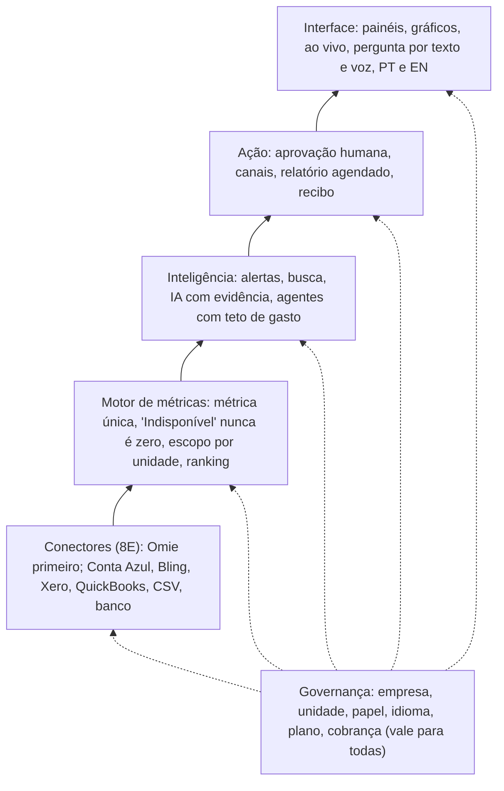
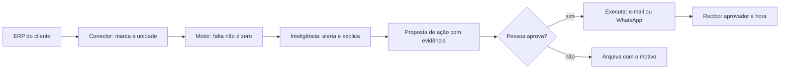

# Arquitetura-alvo do Command V2

**Status:** proposta de desenho (16/10/2026), baseada na pesquisa de concorrência do mesmo dia. Serve de fundação: nenhuma etapa nova deve contrariar este documento sem decisão registrada do Diretor Executivo. Leia junto com `docs/V2-VISAO-E-DECISOES.md` e `docs/CRONOGRAMA-V2.md`.

O V2 é o Command **comercial**, vendido a empresas clientes. Não tem relação com produtos da FM (Kordena, Iron Fit, AtendeVendeIA, NFCore).

## Em uma frase

O V2 lê os sistemas que o cliente já usa (no Brasil, o **Omie primeiro**), transforma o dado em número confiável, explica e avisa com evidência, e só age depois da aprovação de uma pessoa, em qualquer país de língua inglesa e no Brasil.

## Onde ele compete

- **Para ficar no páreo** com Power BI, Databox e os ERPs brasileiros, precisa igualar: gráficos, números ao vivo e dados do ERP do cliente.
- **Para passar à frente**, precisa provar: várias filiais sem time de dados, IA que não inventa número, ação com aprovação humana, contratação online sem projeto de implantação.

Fontes e limites: pesquisa de concorrência (projeto "Sites", `claude/pesquisa-concorrencia-fm-command-v2.md`). Quase todas as fontes são de fornecedores concorrentes; preços e afirmações precisam de conferência direta.

## As seis camadas

| Camada | Faz | Já existe | Falta | Etapa |
|---|---|---|---|---|
| Conectores | Trazem vendas, financeiro e unidades do ERP do cliente, configurados por empresa | Entrada de dados genérica no motor | Um conector por sistema; credencial do cliente fora do código; gravar a unidade de origem | 8E |
| Motor de métricas | Cada métrica definida uma vez, com unidade de origem; ausente fica "Indisponível" | Motor, escopo por unidade (ADR-019), regra do zero | Consolidação e ranking entre filiais, filtro por região | 9B |
| Inteligência | Alertas, busca, avisos, IA que explica citando a evidência | Alertas e busca por escopo, pergunta ao Core assíncrona, roteador de provedores | IA com evidência; orquestrador com teto por agente | 11 |
| Ação | Executa alertas, relatórios e exportações só depois da aprovação de uma pessoa | Fila de trabalho com repetição | Aprovação humana, canais (e-mail, WhatsApp), recibo de cada envio | 12 |
| Interface | Gráficos, números ao vivo, pergunta por texto e voz, PT e EN | Telas em português, ditar e ouvir (parte 1) | Gráficos, atualização sem recarregar, telas em inglês, data e fuso por empresa | 9B, 9T, 10 |
| Governança | Empresa, unidade, papel, idioma, plano e cobrança valem em todas as camadas | Organizações, permissão por unidade, cobrança por provedor configurável | Teste com banco real; tela de configuração de preços e provedores | 8 (resto), 9T |

## Caminho de um dado até virar ação

A IA só propõe. O recibo guarda quem aprovou, quando e com que evidência; recusar também fica registrado.

## Regras que a arquitetura nunca quebra

1. **Ausente nunca é zero.** Dado que o ERP não entrega aparece como "Indisponível" em número, gráfico, alerta e resposta da IA.
2. **Nada fixo no código.** Banco, país, provedor de IA, ERP e setor são configuração por empresa.
3. **Número único.** Gráfico, alerta e IA leem o mesmo motor de métricas; nenhum recalcula por conta própria.
4. **Escopo antes de ler.** Toda leitura passa por empresa e unidade; sem permissão, nada aparece, nem agregado da empresa.
5. **IA propõe, pessoa decide.** Nenhuma ação externa sem aprovação humana e recibo.
6. **IA fora do caminho do painel.** Se o provedor de IA cair ou ficar lento, painel e alertas continuam.
7. **Sem produto da FM dentro.** O V2 comercial não carrega código de Kordena, Iron Fit, AtendeVendeIA nem NFCore.
8. **Ler os ERPs, não substituí-los.** O V2 não emite nota, não controla estoque e não faz o financeiro do cliente.

## Ordem de construção

1. Limpeza do código herdado da FM (inventário classificado primeiro; nada é apagado antes do Diretor ver).
2. Etapa 8E, conectores: **Omie primeiro** (decisão do Diretor, 16/10), depois Conta Azul e Bling (Brasil), Xero e QuickBooks (países de língua inglesa), planilha/CSV e banco de dados.
3. 9T (telas em inglês, data e fuso por empresa), 9B (gráficos, consolidação, ranking, região), 10 (ao vivo), 11 (IA com evidência, agentes), 12 (ação com aprovação).

## Riscos conhecidos

- **APIs de terceiros mudam.** Cada conector precisa de teste contínuo e de aviso ao cliente quando o dado para de chegar.
- **Dado ruim no ERP gera número errado.** O V2 mostra a origem de cada número, mas não corrige o ERP.
- **IA com evidência é a etapa mais difícil.** Hoje existe só a base (roteador, pergunta ao Core, regra do zero).
- **Provedores de IA e de canais ainda simulados.** Sem chave real e teto de gasto, as camadas de inteligência e de ação não têm prova com serviço de verdade.
- **Marca e prova social** dependem de clientes reais, não da arquitetura.

## Decisões que dependem do Diretor Executivo

- Aprovar este desenho como alvo e a ordem acima.
- Quem calcula e recolhe imposto sobre a assinatura (adiado: "decidir depois").
- Chave de provedor de IA com teto de gasto; escolha de e-mail e WhatsApp (etapas 11 e 12).
