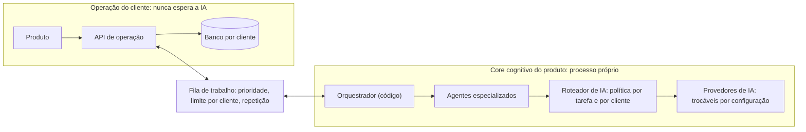
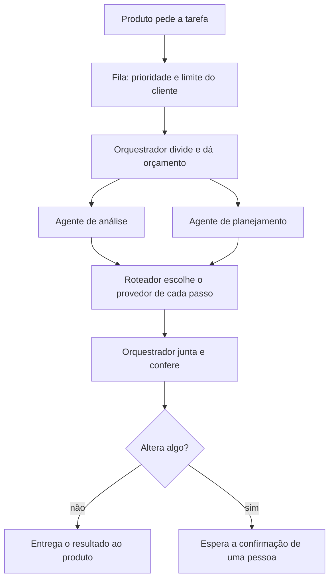

# FM Command V2: arquitetura do core cognitivo

**Status:** PROPOSTA, aguardando aprovação do Diretor Executivo
**Data:** 15/10/2026
**Origem:** documento "Arquitetura do core cognitivo FM" (https://claude.ai/code/artifact/09850ee9-77b7-4b30-abd6-c1ee62fa09a4), escrito a partir da leitura do código do Core Base, do FM Command V1, do fm-ai-platform (Kordena) e do AtendeVendeIA. **Nada foi medido em carga.** As afirmações sobre o que "existe hoje" vêm da leitura do código.

Esta arquitetura respeita o ADR-013 (core cognitivo próprio do produto). Onde ela exige mudar uma decisão anterior, isso está dito e registrado em um ADR novo (ADR-015 a ADR-020).

## 1. Regras

1. A operação do cliente (painéis, alertas, cobrança, integrações) nunca depende da IA nem divide processo com ela.
2. A IA propõe e o sistema decide: valores vêm do motor de métricas e das regras, e ação que altera algo exige pré-visualização e confirmação.
3. Cada cliente é isolado dos outros, e cada chamada de IA é auditada, com custo por cliente.
4. Credenciais, provedores de IA e meios de pagamento ficam em configuração, nunca no código.
5. O core escolhe o provedor por uma política configurada, e não por uma IA escolhendo outra IA.
6. Todo agente tem orçamento de passos, tokens e tempo, e sem orçamento não executa.
7. Idioma, moeda, fuso e região dos dados são configuração por cliente, para vender em vários países.

As regras 2, 3 e 4 já existem no código da V1. As demais são decisões novas.

## 2. Visão geral

Em todas as camadas: auditoria, custo por cliente, permissão por unidade, idioma e região.

## 3. Core do produto e fundação compartilhada

O ADR-013 define que o FM Command possui o seu core cognitivo, com ciclo de vida próprio, e que o que se compartilha entre produtos é a **fundação**: contratos, padrões, adaptadores, observabilidade, segurança e avaliação. O Core Base (Python) é a fundação em evolução; o Command V2 é TypeScript.

Consequência: o que o Command V2 reaproveita do Core Base são os **contratos e os padrões**, implementados no seu próprio código, e não o mesmo programa em execução. Os contratos a manter iguais nos dois lados:

- formato de tarefa na fila (tipo, cliente, prioridade, prazo, orçamento);
- política de roteamento (tabela por tipo de tarefa e por cliente);
- resposta tipada de decisão (escolha, nota ou sim/não, com probabilidade);
- evento de uso e custo por chamada de IA.

O custo é implementar duas vezes, em duas linguagens. O ganho é não acoplar o ciclo de versões, a disponibilidade e o custo de um produto ao de outro, que é o motivo do ADR-013.

## 4. Componentes

| Componente | O que faz | Hoje (leitura do código) | Falta |
|---|---|---|---|
| Operação separada da IA | Mantém painel, alertas e cobrança fora do caminho da IA | No Command, a rota do core faz duas chamadas seguidas à IA dentro de uma requisição. No Kordena, PDV, KDS e rotas com IA estão no mesmo aplicativo | Rotas com IA em processo e rota próprios |
| Fila de trabalho | Prioridade, limite por cliente, prazo, repetição | Existe fila no banco no faturamento do Command (SKIP LOCKED, lease, tentativas). O ADR-011 deixou fila geral DEFERRED | Fila do core, condicionada à medição (ADR-018) |
| Orquestrador | Divide a tarefa, dá prazo e orçamento | Não existe; o planejamento é uma chamada à IA em sequência fixa | Construir em código, com contratos tipados |
| Agentes especializados | Poucas ferramentas permitidas cada | O Gerente IA do Kordena limita a IA a uma lista de ferramentas com confirmação | Generalizar e limitar passos |
| Roteador de IA | Escolhe provedor por tarefa e por cliente | Command: um provedor por variável de ambiente, sem modelo reserva. Core Base: prioridade e reserva por 3 tipos de tarefa, 2 adaptadores | Mais tipos de tarefa, divisão por peso, política por cliente, limite e disjuntor por provedor |

## 5. Roteamento de IA por tarefa e por cliente

Uma tabela configurável, uma linha por tipo de tarefa, com linhas extras por cliente. Os provedores abaixo são só exemplo.

| Tarefa | Principal (exemplo) | Reserva (exemplo) | Observação |
|---|---|---|---|
| Análise e explicação | O melhor na avaliação | O segundo | Menos volume, mais raciocínio |
| Decisão rápida | Modelo barato com resposta tipada | Outro modelo barato | Triagem, conferência e prioridade |
| Cliente grande | Dois provedores dedicados, dividindo por peso | Cada um reserva do outro | Chaves da FM ou do cliente, lista de provedores permitidos |

- A linha mais específica vence: a do cliente antes da padrão.
- Provedores no mesmo nível dividem a carga por peso.
- Cada provedor tem limite de chamadas simultâneas e disjuntor.
- Sem provedor permitido disponível, a tarefa falha com aviso e nunca usa um provedor proibido pelo cliente.
- Um provedor exclusivo por tarefa isola cota e falha, mas precisa de reserva atrás dele.

## 6. Decisões rápidas

Um tipo de tarefa "decisão" no roteador, com resposta limitada a uma escolha, uma nota ou um sim/não, mais a probabilidade. Usos: triagem na entrada, escolha de métricas e produtos de um catálogo fechado (hoje feita por uma chamada ao LLM no planejador), conferência de rascunhos e prioridade da fila. Abaixo de um limite de probabilidade, vai para uma pessoa.

Qualquer modelo barato pode cumprir a tarefa. O Jev (TypeSafe) é só um candidato a adaptador, depois de teste com dados sintéticos: é proprietário, está em acesso antecipado e suas alegações de custo e velocidade são do fornecedor. Permissão e confirmação continuam no código.

## 7. Fluxo de uma tarefa

Se um agente estoura o orçamento, o orquestrador entrega o que já tem e avisa.

## 8. Plano em etapas

Cada etapa vira uma branch e um PR, e só a seguinte começa com aprovação expressa. Nenhuma data foi definida.

| Etapa | O que entrega | Como se mede |
|---|---|---|
| 1. Medir | Teste de carga no caminho da IA, com provedor simulado | Limite real de requisições e tempo de resposta |
| 2. Separar a IA da operação | Rotas com IA em processo próprio | Painel e alertas sem lentidão com a IA sob carga |
| 3. Hierarquia de unidades | Matriz, filiais e regiões, com permissão por unidade | Testes de isolamento entre unidades |
| 4. Fila de trabalho | Fila com worker, prioridade, limite por cliente e repetição | Tarefas concluídas sem perda sob falha provocada |
| 5. Provedores resilientes | Adaptadores, política por tarefa e cliente, limite e disjuntor | Falha de um provedor não derruba a tarefa |
| 5b. Decisões rápidas | Tipo de tarefa "decisão" e teste com dados sintéticos | Concordância, custo e tempo contra o planejador atual |
| 6. Orquestrador e agentes | Piloto em uma funcionalidade | Tarefas dentro do orçamento, nenhuma ação sem confirmação |

## 9. Riscos

- Nada foi medido: o limite real é desconhecido.
- Mais agentes custam mais em dinheiro, tempo e pontos de falha.
- Duas implementações dos mesmos contratos (TypeScript e Python).
- Cota dos provedores: nos testes do AtendeVendeIA o Gemini devolveu 503 e 429.
- Privacidade por cliente e por país: alguns clientes vão proibir certos provedores, e isso precisa de advogado.
- O Core Base é uma cópia isolada de um ponto fixo do fm-ai-platform; mudanças da origem precisam ser reconciliadas.

## 10. Decisões pendentes do Diretor Executivo

1. Aprovar as sete regras como regra constitucional da FM.
2. Aprovar os ADR-015 a ADR-020 (hoje PROPOSED).
3. Autorizar a etapa 1, de medição.
4. Escolher a funcionalidade do piloto de agentes.
5. O provedor de cada tipo de tarefa só é definido depois da bateria de avaliação.
